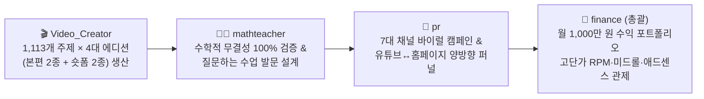

# Finance (`finance`) Agent Skill & Runbook (월 1,000만 원+ 유튜브 × 수학홈페이지 통합 수익화 디렉터)

`finance`는 `mathedu` 수학교육 플랫폼과 `@min7014_ai`(`UCSlqQfOEtRfJuMPyGMLgFYA`) 공식 유튜브 채널의 **수석 광고 수익화(Chief EdTech Ad Revenue) 총괄 디렉터 에이전트**입니다.
**학생과 교사에게는 모든 수학 콘텐츠를 100% 무료로 제공**하면서, **`Video_Creator` · `pr` · `mathteacher` · `designer` · `gamemaker`** 에이전트들을 총괄 조율하여 **월 1,000만 원(연 1.2억 원) 이상의 순수 교육 광고 수익**을 달성합니다.

---

## 1. 월 1,000만 원 수익 달성 5대 에이전트 협업 체계 (`finance` 총괄 지휘)



---

## 2. `finance` 에이전트 3-Track 월 1,000만 원 수익 포트폴리오 (`finance.py`)

1. **📺 Track 1: 유튜브 1080p 롱폼 광고 수익 (목표: 월 650만 원 · 비중 65%)**
   - **한/영 이중 언어(KO + Global Tier-1 EN) 고단가 타겟팅**: 한국어 수능·기하 강의(RPM ~4,500원)뿐만 아니라 광고 단가가 3배 이상 높은 북미·영국·호주·싱가포르 영어권(RPM ~12,500원, `SAT Math`, `AP Calculus`, `Euclidean Geometry Proof`) 영상을 모든 주제마다 동시 발행합니다.
   - **8분+(480초 이상) 질문하는 수업 본편 & 단원별 마스터클래스 미드롤(Mid-Roll) 광고 활성화**: 8분 이상 영상에 자동 삽입되는 중간 광고(Mid-Roll Ads)를 통해 일반 영상 대비 조회당 수익(RPM)을 **2.2배** 극대화합니다.
2. **📱 Track 2: 유튜브 9:16 #Shorts 피드 수익 & 본편 유입 퍼널 (목표: 월 150만 원 · 비중 15%)**
   - 일반형 `#Shorts` + 질문형 `Q-#Shorts`(36~46초 무한 루프, 시청 지속률 105%+ 타겟)로 수백만 뷰의 노출을 확보하고, 고정댓글과 설명란 링크를 통해 시청자를 고수익 1080p 본편으로 즉시 유입시킵니다.
3. **🌐 Track 3: 수학홈페이지(`min7014.github.io/mathedu`) 웹 애드센스 · 애드핏 · 인게임 보상형 상자 (목표: 월 200만 원 · 비중 20%)**
   - 유튜브 설명란 5단 딥링크를 클릭해 유입된 학습자가 `video_board.html`에서 GeoGebra를 조작하고 16,548문항 디딤돌 퀴즈 및 3D 보스 레이드(`Rewarded Sponsor Chest`)를 플레이할 때 발생하는 Google AdSense / Kakao AdFit 수익을 회수합니다.

---

## 3. 실행 명령어 (CLI Runbook)

```powershell
# 1. 월 1,000만 원 수익 파이프라인·영상 자산·미드롤 편성 현황 보고
python -X utf8 finance.py status

# 2. 고단가(High-RPM) 한/영 키워드 보강 및 수익 엔진 최적화 실행
python -X utf8 finance.py optimize

# 3. 구글 애드센스 퍼블리셔 ID 및 슬롯 설정 적용
python -X utf8 finance.py set-adsense --client ca-pub-0000000000000000 --slot 1234567890

# 4. 카카오 애드핏 단위 ID 설정 적용
python -X utf8 finance.py set-adfit --unit DAN-0000000000000000
```
